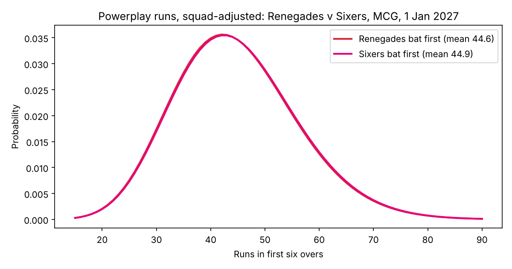

# BBL match prediction: Melbourne Renegades v Sydney Sixers

**Repository:** https://github.com/raskutti/bbl-prediction

Pre-toss forecasts for the men's BBL match at the **MCG, Fri 1 Jan 2027, 4.00pm** (full 20 overs):
(1) the probability the Renegades win; (2) the distribution of runs in the first six overs for each
side batting first. Reproduce everything with `make install && make data && make all` (~40 seconds).



## Predictions

| | Prediction | Basis |
|---|---|---|
| **P(Renegades win)** | **0.43** (range 0.38 to 0.50) | Model output 0.41, nudged up for roster churn (a judgement call, not backtested). The range runs from the bootstrap lower bound to the 50%-shrink case. |
| Renegades powerplay (bat first) | mean 44.6, sd 11.4, median 44, 90% range 27 to 65 | Squad-adjusted model |
| Sixers powerplay (bat first) | mean 44.9, sd 11.5, median 44, 90% range 28 to 65 | Squad-adjusted model |

Full distributions (0 to 160 runs): [`results/pp_pmf_squad_adjusted_full.csv`](results/pp_pmf_squad_adjusted_full.csv).

**Assumptions.** No rain reduction or abandonment. The Renegades are the home side (the MCG is their new
home ground for BBL|16); as a neutral match the win probability would be 0.35. The data ends in January 2026,
so no 2026/27 games are in the model. Powerplay line-ups are scenarios, not announced XIs. Steve Smith is
excluded: the match falls between the Boxing Day and New Year Tests against New Zealand. No other player is excluded as a Test player (the Test squad was not yet named). The toss changes the pre-toss
win probability by under 0.5 points.

## Methodology

**Data.** Cricsheet ball-by-ball men's BBL, 2011/12 to 2025/26: 662 matches, of which 615 are completed
full-length games (no-results and rain-reduced games are dropped). For the powerplay, 1,248 innings (short and
rain-affected innings dropped). Public squad news (23 Nov 2026) is used only for the scenarios below.

**1. Win probability** (`match_model.py`, `match_predict.py`)

- *Elo.* Ratings start at 1500 and move by K x (result - expected), with optional regression to 1500 between seasons. The Elo probability is recalibrated by a logistic regression (slope 0.96, home term 0.20). Deployed: K = 8, no regression.
- *Bradley-Terry.* P(A beats B) = logistic(strength_A - strength_B + h x home), fitted by ridge-penalised logistic regression with matches weighted 0.5^(age / half-life). Deployed: half-life 2 years, ridge 4, h = 0.36.
- *Home.* +1/-1/0 by whether a club is playing in its home city. Both Melbourne clubs count as home at the MCG (a simplification).
- *Combination.* 50/50 average of the two. A bootstrap over matches gives a 90% interval of 0.38 to 0.56 for the Bradley-Terry component.
- *Roster-churn sensitivity.* The ratings predate the new squads, so the strength gap is shrunk toward zero to show the effect: keeping 100% of it gives 0.41, 75% gives 0.45, 50% gives 0.49 (`results/match_prediction.json`). The 0.43 headline sits inside this range. No shrink factor has been backtested.

**2. Powerplay runs** (`powerplay_model.py`, `negbin.py`, `player_layer.py`, `player_scenarios.py`)

- *Distribution.* Powerplay runs have variance about 3x the mean, so Poisson is rejected. Runs follow a negative binomial: y ~ NB(mu, alpha), variance = mu + alpha x mu^2, alpha about 0.04.
- *Mean.* log mu = intercept + second-innings effect + venue effect (ridge-shrunk, 14 venues), plus optional batting-team and bowling-team effects. Observations are time-decayed; fitting is by L-BFGS with analytic gradients.
- *Team-level answer.* An equal mixture of an all-history fit and a one-year half-life fit (hedging uncertainty in the league scoring level): means 42.7 (Renegades) and 41.6 (Sixers).
- *Player layer (primary answer).* Each batter and bowler gets an empirical-Bayes rating from earlier seasons: (runs + 60 x league rate) / (balls + 60) per legal ball in overs 1 to 6. The line-up's average rating, in runs per over versus the league, enters as a covariate: log mu = log mu(venue, innings) + b_bat x f_bat + b_bowl x f_bowl, with b fitted by ridge on the out-of-sample backtest rows (leave-one-season-out when evaluating). Players with no BBL history get a neutral rating.
- *Scenarios.* The forecast averages plausible opening pairs and powerplay bowling attacks for each side (`player_scenarios.py`, with sources), with Smith excluded.

**3. Evaluation protocol.** Rolling origin, 2016/17 to 2025/26: for each test season, hyperparameters and models use only earlier seasons (pool from 2013/14). Match results are scored by log loss and Brier score against a coin flip; powerplay distributions by mean log score, PIT calibration and interval coverage. Intervals are bootstrap 95% over matches or innings.

## Evaluation

**Match result** (469 matches; coin flip = 0.6931 log loss)

| Model | Log loss | vs coin flip, 95% CI |
|---|---|---|
| Home-only | 0.6907 | -0.0024 [-0.0067, +0.0019] |
| Elo + home | 0.6859 | -0.0072 [-0.0202, +0.0059] |
| Bradley-Terry | 0.6857 | -0.0075 [-0.0247, +0.0116] |
| **Ensemble** | **0.6844** | **-0.0087 [-0.0246, +0.0076]** |

The ensemble beats a coin flip, but every interval includes zero, so the edge is not established. It is
concentrated early in each season (log loss 0.6689 over the first 40%), which is closest to this fixture.
Calibration is noisy (about 117 matches per quartile; the top quartile averaged 60% and won 52%).
Brier scores and more are in [`results/match_eval.csv`](results/match_eval.csv).

**Powerplay runs** (950 innings; mean log score per innings)

| Model | Log score | Gain, 95% CI |
|---|---|---|
| League-wide NB | -3.8866 | baseline |
| + venue and innings | -3.8765 | +0.0101 [+0.0000, +0.0204] vs league |
| + team effects | -3.8776 | +0.0091 [-0.0045, +0.0221] vs league |
| + batter rating | -3.8569 | **+0.0196 [+0.0058, +0.0340] vs venue+innings** |
| + batter and bowler ratings | -3.8535 | +0.0230 [+0.0075, +0.0385] vs venue+innings |

The central 80% and 90% intervals covered 81.2% and 89.8% of innings and the PIT histogram is near flat.
The batter rating is the only component with a clear gain; team effects are indistinguishable from noise.

## Limitations and next steps

- **Weak signal.** Match-result gains are not statistically established; powerplay gains are small.
- **Optimistic player backtest.** It uses batters who actually faced powerplay balls ("XI known"). Pre-toss, personnel are scenarios.
- **Level drift.** The last two seasons ran about 4 runs hotter than pre-season predictions league-wide, while the MCG ran low. Whether that holds for a 4pm January start is untested (`powerplay_drift.py`).
- **Narrow distribution.** The squad-adjusted forecast is one NB around the scenario-average mean, so it omits line-up and level uncertainty and is probably slightly too narrow.
- **Not modelled:** toss, afternoon conditions, weather, pitch. Team effects were learned mostly at Marvel Stadium, not the MCG.
- **Next:** re-run with the announced XIs; backtest the churn shrink on past season boundaries; add a wickets-aware ball-by-ball simulation as an alternative; compare against market prices as a benchmark, not an input.

## Repository

```
src/bbl/   config.py (fixture and paths) | load_cricsheet.py | common.py | eda.py
           match_model.py, match_predict.py | negbin.py, powerplay_model.py, powerplay_drift.py,
           powerplay_predict.py | player_layer.py, player_scenarios.py
tests/     loader, helpers, negative-binomial likelihood (11 tests)
results/   committed outputs: CSVs, charts, logs/ (console output of every stage)
data/      not committed; see data/README.md
```

Each stage imports the stage it builds on and silently re-runs its backtest, so results stay traceable.
`make eda | match | powerplay | players` runs individual stages; `make test` runs the tests.

Data: [Cricsheet](https://cricsheet.org) (check its terms before redistributing). Squad news is as at
23 November 2026 and will have changed by match day.
